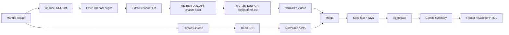

# YouTube + Threads Weekly Digest (n8n)

An n8n workflow that turns a list of YouTube channels and a Threads account into a short, linked weekly newsletter written by Gemini.

## What it does

1. Paste any public YouTube channel URL (`/@handle`, `/c/name` or `/channel/UC...`). The flow resolves the channel ID and fetches recent uploads with the YouTube Data API v3.
2. A Threads account is read through an RSSHub feed.
3. Items from the last 7 days are merged, summarized by Gemini with source links, and rendered to HTML.

The output is a preview only. No email node is included, so nothing is sent.

## Setup

1. In n8n choose **Import from File** and select [workflow.json](./workflow.json).
2. Create a YouTube Data API v3 key in Google Cloud Console (enable "YouTube Data API v3").
3. In n8n **Credentials**, create a **Query Auth** credential with name `key` and your API key as the value. Attach it to the two `Get YouTube ...` / `Get Recent Uploads` HTTP nodes.
4. Create a **Google Gemini (PaLM) API** credential and attach it to `Google Gemini Model`.
5. Edit `Channel URL List` (channels) and `Threads Source` (username, currently `zuck`).
6. Click **Execute workflow**. The newsletter appears in the `Format Newsletter HTML` node (`output` is Markdown, `emailHtml` is HTML).

Quota: each run costs about 1 unit per channel for each of the two YouTube API calls, against the default 10,000 units per day.

## Turning it into a real newsletter

- Replace the manual trigger with a Schedule Trigger.
- Add a Send Email node after `Format Newsletter HTML` using `{{ $json.emailHtml }}` as the HTML body and your own SMTP credential.

## Notes

- The legacy YouTube RSS feeds (`feeds/videos.xml`) returned 404 during development, which is why the Data API is used.
- RSSHub public instances can be rate limited. Self-host one for reliability.
- This export contains no credentials, email addresses or pinned data. Review any export before publishing your own.

See [sample-digest.md](./sample-digest.md) for an example output.
